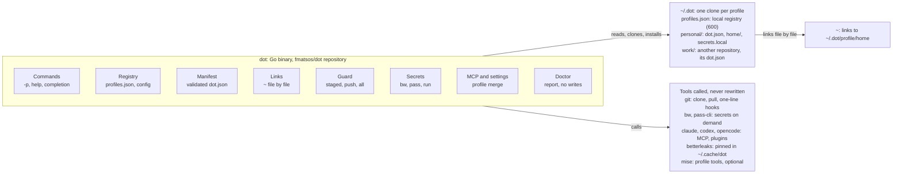
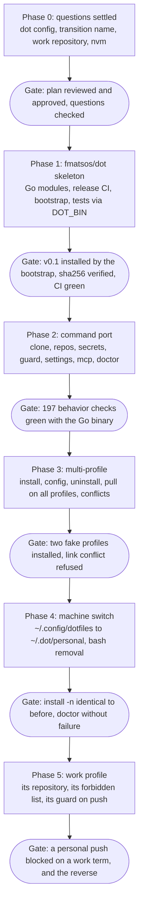

# dot v2 plan: Go and multiple profiles

Status: phases 1 to 3 implemented (see the progress section at the end); phases 4 and 5 to do.

## Context and goals

dot v2 moves the dotfiles CLI into a dedicated repository `fmatsos/dot`, rewritten in Go, able to manage one or several profiles, each carried by its own data repository.

Starting point (6 October 2026):

- `dot` is a bash CLI of about 1,000 lines (plus 100 lines of awk) in the `fmatsos/dotfiles` repository, covered by 14 black-box test scripts (233 checks).
- Step 1 is delivered (commit `e876d53`): every value specific to the repository lives in a `dot.json` manifest, none left in the code.
- The engine and the data still share the same repository, and a single profile exists.

Goals of v2:

1. **A public, agnostic engine**: no personal or professional value in `fmatsos/dot`.
2. **Several profiles**: one data repository per profile (personal, work...), installed side by side on one machine.
3. **A standalone binary**: `dot` installs and runs without mise, without bash 4.4, on Linux and macOS.
4. **No regression**: current behaviors (links, guard, secrets, MCP, doctor) stay identical, proven by the existing tests.

## Decisions made

Ten decisions are settled; they are not reopened during implementation.

| Topic | Decision |
| --- | --- |
| Language | Go, one static binary per platform |
| CLI library | cobra: generated help and zsh completion, one accepted dependency |
| Repository | `fmatsos/dot`, public, with no value specific to a user |
| Profile location | `~/.dot/<key>`, one clone per profile |
| Registry | `~/.dot/profiles.json`, specific to the machine, created by `dot install`, changed by `dot config` |
| Targeting | `-p/--profile <key>`, then `DOT_PROFILE`, then the registry's default profile |
| Scope without `-p` | `pull` and `doctor` act on all profiles; the other commands on the default profile |
| Link conflict | two profiles linking the same file in `~`: installation refused |
| `install.sh` | kept as the minimal bootstrap for a fresh machine |
| `dot profile` | keeps its name and role: git `includeIf` identity rules |

mise stays the tool manager (node, pinned CLIs), declared in the data, but `dot` itself no longer depends on it. Profile keys that name an employer only appear in the local registry and in that profile's repository.

## Architecture of the fmatsos/dot repository

One Go binary carries all the logic; profiles only hold data, and existing tools are called, never rewritten.

*A standalone binary orchestrates the profiles and the existing tools.*



Each package lives in `internal/<name>` and only depends on the manifest and the registry; the commands live in `cmd/dot`.

```text
fmatsos/dot/
├── cmd/dot/            entry point, global options (-p, --version)
├── internal/registry/  profiles.json: read, atomic write, validation
├── internal/manifest/  dot.json: structs, unknown keys refused
├── internal/link/      links, backups, purge, conflicts between profiles
├── internal/guard/     guard, pinned betterleaks
├── internal/secrets/   bw, pass-cli, run
├── internal/mcp/       merge and rendering for Claude, Codex, OpenCode
├── tests/              the current bash scripts, black-box contract
└── install.sh          minimal bootstrap
```

**Extensions**: as today, `dot <cmd>` runs an executable `dot-<cmd>` found in a profile's `bin/` or in the `PATH`; a name claimed by two profiles is refused.

## Profile model

A profile is a data repository cloned into `~/.dot/<key>`; the registry only keeps its key and URL, the path is derived.

```text
~/.dot/
├── profiles.json      local registry (600), never versioned
├── personal/          clone: dot.json, home/, bin/, secrets.local, forbidden.local
└── work/              clone of another repository, with its own dot.json
```

```json
{ "default": "personal",
  "profiles": {
    "personal": { "repo": "https://github.com/<user>/dotfiles.git" },
    "work":     { "repo": "<private repository>" } } }
```

**Each profile's `dot.json`** keeps the step 1 schema, without `deploy.path` (the path comes from the registry): sparse clone directories, git profiles and the clone's identity profile, marketplace and plugins, nvm packages, modules run after installation.

**Registry commands**

| Command | Effect |
| --- | --- |
| `dot install <url> [-p <key>]` | clones into `~/.dot/<key>`, adds it to the registry (created if needed; the first profile becomes the default), installs |
| `dot install` | reinstalls all registered profiles |
| `dot uninstall -p <key>` | removes the profile's links, then its entry; the clone is kept unless `--purge` |
| `dot config list` | prints the registry |
| `dot config get <key>` | reads a value (`default`, `profiles.work.repo`) |
| `dot config set <key> <value>` | writes a validated value, atomically |
| `dot config unset <key>` | removes a value; refuses a profile that is still installed |

**Composition between profiles**: never by overwriting files, always through the existing include mechanisms.

- Git: each profile brings its `profiles/<name>.gitconfig` and its `includeIf` rules, included from `~/.gitconfig`.
- MCP: `dot mcp` merges the `servers.json` of all profiles, in registry order, then `servers.local.json`.
- Claude settings: `dot settings` merges the `settings.base.json` of all profiles in the same order.
- Links: a file claimed by two profiles blocks `dot install`, with both paths in the message.

## Distribution and bootstrap

`dot` is installed from a GitHub release verified by sha256, without mise or `curl | sh`; mise is still installed afterwards through the data, for the other tools.

**Releases** (CI of the `fmatsos/dot` repository, on a `vX.Y.Z` tag):

- static binaries `linux-x64`, `linux-arm64`, `macos-x64`, `macos-arm64` (`CGO_ENABLED=0`);
- a `SHA256SUMS` file published with the release;
- the version is stamped into the binary (`dot --version`).

**`install.sh` bootstrap** (about thirty lines, versioned in `fmatsos/dot`):

1. detect the platform;
2. download the release pinned in the script and verify it against the sum written in the script;
3. install it into `~/.local/bin/dot`;
4. run `dot install <url of the first profile>`.

A new version of `dot` is published by changing the version and the sum in the bootstrap (`scripts/pin-install.sh`), then `dot self-update` on the machines. A sum published with the release proves nothing against a compromised release, and an installed binary cannot know the sum of a future version: `SHA256SUMS` is therefore signed with Ed25519 (OpenSSL 3 in CI, secret `RELEASE_SIGNING_KEY`), and `self-update` verifies this signature with the public key compiled into the binary (`crypto/ed25519`, no dependency) before verifying the binary's sum.

**Side tools**: `dot guard` downloads the pinned version of betterleaks itself (sha256 compiled into the binary) into `~/.cache/dot/`, which makes the guard independent of the `PATH` of graphical git clients. Then `dot install` installs mise (pinned version and sha256, as today) only if a profile declares a `config.toml`.

## Guard and secrets

The guard moves into the binary (`dot guard`) with the same rules as today; each profile brings its own list of forbidden terms.

**`dot guard staged | msg <file> | push | all`**

- Repository hooks become one-line calls: `exec dot guard staged`.
- It fails closed: a missing, empty or invalid list, a failing git command, an unavailable scanner, everything blocks.
- It only reports file names or commits, never the text found.
- File names are read NUL-separated, without git quoting.
- betterleaks runs with `--redact`, from the pinned copy in `~/.cache/dot/`.

**Which list for which repository**: the global `pre-push` hook reads `dotfiles.profile` of the pushed repository and applies `~/.dot/<that profile>/forbidden.local`. A personal repository is therefore checked against the work terms, a work repository against its own terms. `dotfiles.guard secrets` (betterleaks only) is kept for repositories that quote an employer on purpose.

**Secrets (`dot secrets`)**: behavior unchanged.

- Each profile has its `secrets.local` (`NAME=bw:<item>` or `NAME=pass:<vault>/<item>`).
- Values never go through a process argument: environment limited to one command, or stdin.
- `run` resolves all the values before launching the command, then replaces the process with it (`syscall.Exec`).
- Bitwarden session: `BW_SESSION` or the `bw-session.local` cache (600).
- The tests use fake CLIs placed first in the `PATH`.

## Migration strategy

The 14 bash test scripts remain the contract: the Go binary must pass them as they are, command by command, before any bash is removed.

**The contract**: 197 of the current 233 checks test a behavior (secrets, guard, doctor, MCP, repos, clone, hooks, settings, purge) and stay valid for the Go binary. They need a single mechanical change: they currently run `bash "$root/bin/dot-..."`, they will go through `"$DOT_BIN" <cmd>`, which picks the implementation under test. The messages are part of the contract.

The other 36 test the bash implementation: they are replaced, not ported, and this work is counted in phases 1 and 2.

| Current tests | Checks | Fate |
| --- | --- | --- |
| `help.sh` | 12 | help generated by cobra: a few output tests of `dot --help`; the `dot terms` test is kept |
| `completion.sh` | 8 | completion generated by cobra: new tests on `dot __complete` |
| `manifest.sh` | 10 | `dot.json` validation: same cases, as Go unit tests (`internal/manifest`) |
| `install.sh` | 6 | the bootstrap changes: an end-to-end test of the bootstrap, then of `dot install` |
| `prompt.sh` | 1 | shellkit block, outside `dot`: stays in the data repository |

**Porting order** (from the most isolated to the most central):

1. `clone`, `repos`, `profile`, `whoami`
2. `secrets`
3. `guard` (and one-line hooks)
4. `settings`, `mcp`
5. `doctor`
6. `install`, `pull`, `config`, `uninstall` and multi-profile, which only exist in Go

**During the transition**, the `fmatsos/dotfiles` repository keeps its bash `bin/`; the Go binary is installed next to it under another name (`dot2`) until the switch.

**Machine switch** (once, by `dot install` in Go):

1. move `~/.config/dotfiles` to `~/.dot/personal`, with its local files (`secrets.local`, `forbidden.local`, `bw-session.local`);
2. create the registry with `personal` as the default;
3. redo all the links from `~` to the new path (the old links are replaced without a backup since they pointed into the clone);
4. remove `bin/`, `.githooks/guard` and `install.sh` from the data repository, which keeps only `dot.json`, `home/` and its one-line hooks;
5. update the README, `CLAUDE.md`, the shellkit block and the memory, which quote `~/.config/dotfiles`.

## Phasing

Six phases, each delivered and verified before the next; no date is set, only the order matters.

*Six phases, each closed by a verifiable criterion.*



Each phase goes through the proven cycle: numbered instructions to Codex, point-by-point review, tests rerun, then delivery. Phase 4 is the only one that touches the real machine; it is done as a dry run first, compared with the state before.

## Risks and open questions

**Risks**

| Risk | Mitigation |
| --- | --- |
| Two implementations diverge during the transition | the same black-box tests for both; bash is only fixed for a vulnerability |
| A leak during the switch (local files copied, badly resolved paths) | move rather than copy, dry run (`-n`) compared with the state before, as for step 1 |
| The guard opens by mistake during the port | its tests (invalid list, accented names, missing scanner) pass before the hooks call the Go version |
| Go dependencies and supply chain | standard library first; each dependency justified and pinned in `go.sum` |
| A broken release deployed everywhere | the bootstrap and `self-update` pin a version; rolling back = reinstalling the previous version |

**Questions to settle before the code**

- [x] CLI library: settled, cobra (see Decisions made).
- [ ] `dot config` currently hides the `git config` passed to the clone: accepted, with `git -C ~/.dot/<key>` as a workaround?
- [ ] Transition name of the Go binary (`dot2`) or direct replacement from the first ported command?
- [ ] The work profile: does its repository already exist, and on which host?
- [ ] Removing nvm: a separate goal, or part of the switch?

## Progress

- Phases 1 to 3: done. All the ported bash tests (`tests/*.sh`) and the Go tests pass.
- Phase 0 questions: the code moved on with these assumptions, to be confirmed.
  - `dot config` hides the `git config` passed to the clone: accepted, `git -C ~/.dot/<key>` as a workaround.
  - Transition name: the binary is built under the name `dot`; installing the executable as `dot2` belongs to phase 4, not to the code.
  - Work profile repository and nvm removal: not handled here (phases 4 and 5).
- Accepted differences from the bash: the guard and the secrets no longer need `jq`; help is generated by cobra (no more `help.awk`); usage errors exit with code 2; forbidden terms are case-insensitive RE2 regexes (POSIX/GNU extensions such as backreferences are refused, failing closed).
- `dot send` is replaced by `dot push [message]`, and `dot status` (alias `st`) becomes a separate command; without `-p`, `pull`, `push`, `status`, `doctor`, `settings` and `mcp` act on all registered profiles, with `==> <key>` in front of each and a failure that does not stop the others.
- betterleaks sums pinned for v1.9.0 (recomputed on the archives, identical to the release's `checksums.txt`).
- Done since: signed releases, `install.sh` bootstrap (not pinned), `dot self-update`, refusal of a `dot-<cmd>` name claimed by two profiles, CI on macOS, completion of profile keys and of `dot config`, `dot backups list|restore`, `dot adopt` (target profile guard before any move), `home@<os>` and `home@<machine>` variants resolved before links and conflicts (`settings`, `mcp` and mise still read `home/` only).
- Guard hardened: an indexed submodule no longer blocks the commit (its name is still checked), a BOM at the start of the list is removed, a term that matches the empty string (`a*`, `^`...) is refused, failing closed. Known blind spot: no Unicode normalization, an NFC term does not find an NFD name (macOS without `core.precomposeunicode`).
- To do: generate the signing key, publish `v0.1.0` then pin the bootstrap, machine switch (phase 4), work profile (phase 5).
